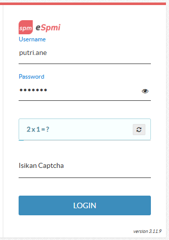
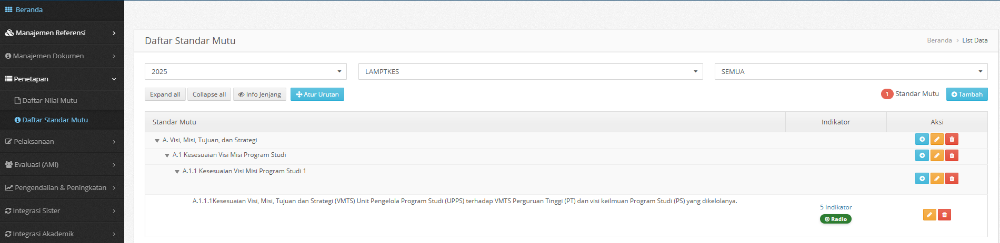
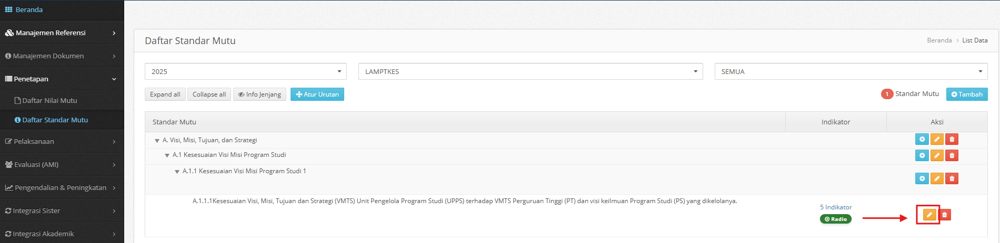
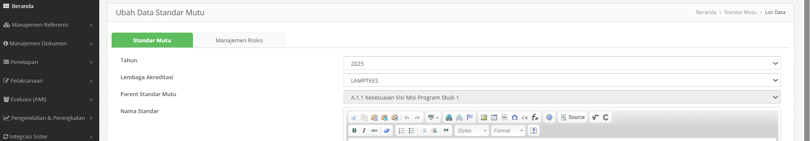
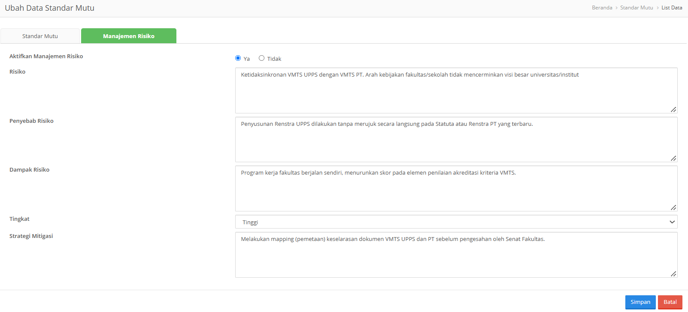

Merupakan fitur yang digunakan untuk mengidentifikasi, mendokumentasikan, dan menentukan strategi mitigasi terhadap risiko yang berpotensi menghambat pencapaian standar mutu. Pengelolaan risiko dilakukan pada setiap instrumen pertanyaan dalam Standar Mutu. Melalui fitur ini, Anda dapat mengidentifikasi potensi risiko, penyebab risiko, dampak yang ditimbulkan, menentukan tingkat risiko, serta merumuskan strategi mitigasi sebagai langkah pengendalian.

<Warning>
  - Pengelolaan risiko dilakukan pada level instrumen pertanyaan (Level 4).
  - Identifikasi risiko harus relevan dengan standar mutu dan instrumen yang dikelola.
  - Tingkat risiko ditentukan berdasarkan hasil penilaian risiko internal perguruan tinggi.
  - Strategi mitigasi sebaiknya disusun berdasarkan penyebab dan dampak risiko yang telah diidentifikasi.
</Warning>

### Cara Mengakses Manajemen Risiko

<Accordion title="1. Login ke aplikasi eSPMI menggunakan akun Anda.">
  Silakan akses halaman login e-SPMI dan masukkan akun Anda untuk mulai mengelola data penjaminan mutu.

  
</Accordion>

<Accordion title="2. Pilih menu Penetapan > Daftar Standar Mutu">
  Halaman akan menampilkan daftar standar mutu dengan hierarkinya.

  
</Accordion>

<Accordion title="3. Klik tombol Ubah pada instumen pertanyaan yang ingin dikelola">
  Sistem akan menampilkan halaman Ubah Data Standar Mutu.

  

  
</Accordion>

<Accordion title="4. Pilih tab Manajemen Risiko">
  Tindakan tersebut untuk membuka formulir pengelolaan risiko. Anda dapat mengaktifkan atau menonaktifkan pengelolaan risiko pada instrumen yang dipilih.

  

  Langkah pengisian formulir Manajemen Risiko:

  1. Aktifkan Manajemen Risiko Pada bagian Aktifkan Manajemen Risiko, pilih **Ya**.
  2. Isi kolom Risiko sesuai dengan potensi risiko pada instrumen tersebut.
  3. Isi kolom Penyebab Risiko berdasarkan faktor yang dapat memicu terjadinya risiko.
  4. Isi kolom Dampak Risiko berdasarkan konsekuensi yang mungkin ditimbulkan.
  5. Tentukan Tingkat Risiko (Tinggi, Sedang, atau Rendah).
  6. Isi Strategi Mitigasi dengan tindakan yang direncanakan untuk mengendalikan risiko.

  

  <Note>
    Apabila pengelolaan risiko tidak diperlukan pada instrumen tersebut, pilih **Tidak** pada bagian Aktifkan Manajemen Risiko.
  </Note>
</Accordion>

<Accordion title="5. Tekan tombol Simpan">
  Dengan klik tombol Simpan, data yang sudah Anda isikan pada form akan disimpan dan Auditee akan dapat melihat informasi terkait Risiko tersebut.
</Accordion>
